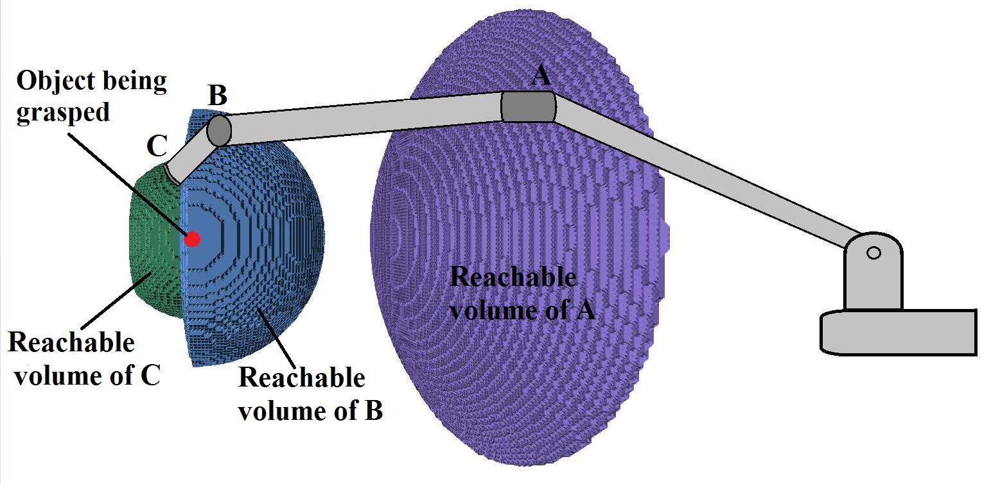
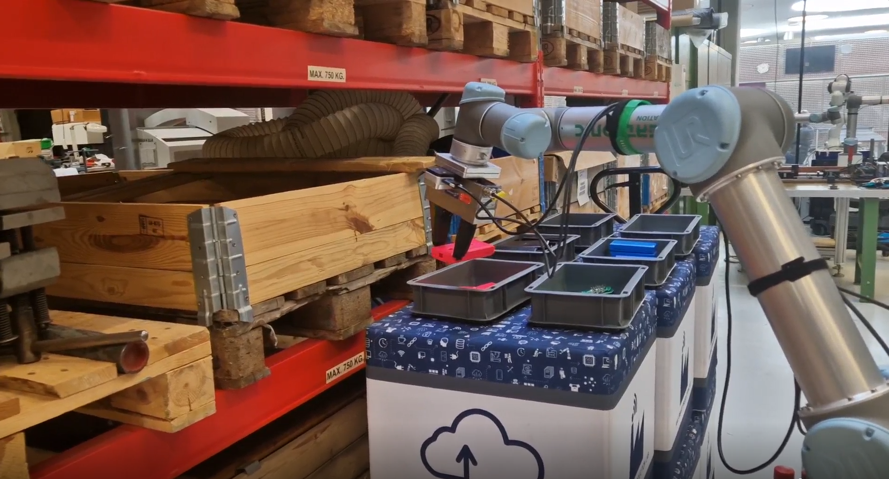
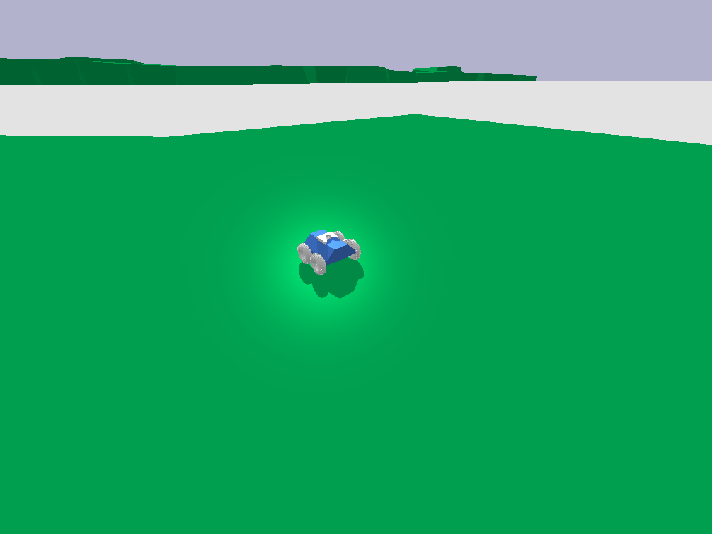
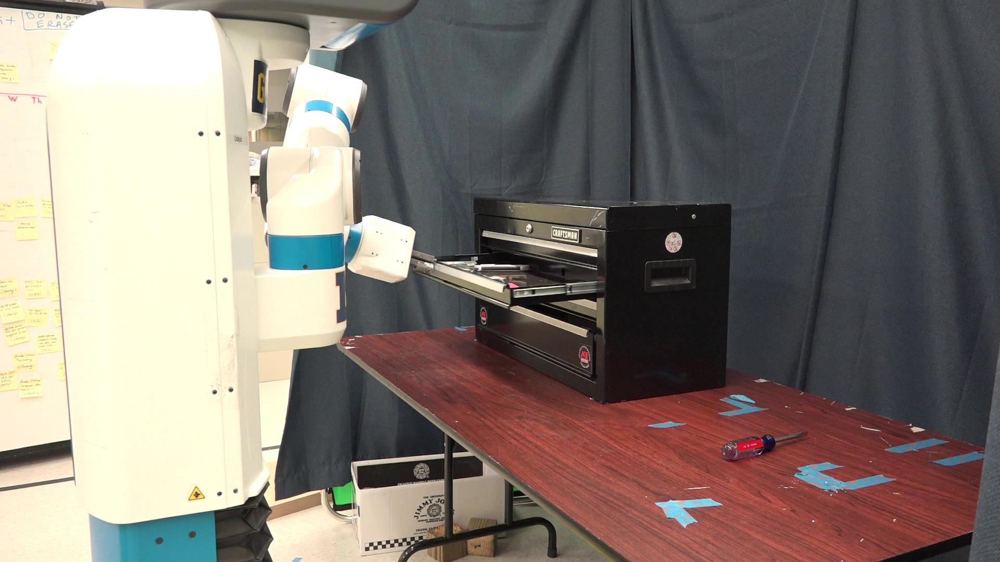
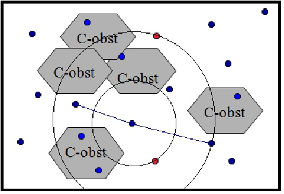

<html lang="en">
<head>
    <meta charset="UTF-8">
    <meta name="viewport" content="width=device-width, initial-scale=1.0">
    <title>Troy McMahon | Roboticist </title>

    
</head>

<body>

<main class="container">

<table>
    <tr>
        <!-- Profile Photo -->
        <td width="50%" valign="top">
            
        </td>

        <!-- Introduction -->
        <td width="50%" valign="top">

            <h1>Dr. Troy A. McMahon</h1>

            <h2>Robotics Researcher</h2>

            

                I am a robotics researcher specializing in motion
                planning for manipulators, constrained systems,
                and high-degree-of-freedom robots.
            

            

                My research focuses on sampling-based motion planning,
                kinodynamic planning, computational geometry, and
                robotic manipulation. I develop algorithms and
                computational techniques for complex robotic systems,
                with applications in industrial automation,
                mobile manipulation, and autonomous vehicles.
            

            

                <b>Research Interests:</b>
                Motion Planning |
                Robotic Manipulation |
                Kinodynamic Planning |
                Industrial Robotics
            

            

            <a href="CV.pdf">CV</a> 
            <a href="ResearchStatement.pdf">Research Statement</a> 
            <a href="TeachingStatement.pdf">Teaching Statement</a> 
            <a href="https://scholar.google.com/citations?user=gG43f88AAAAJ&hl=en">Research Profile</a> 
            <a href="mailto:troymcmahon1@gmail.com">Email</a> 
            

        </td>
    </tr>
</table>
        

        <!-- Projects -->
        <section class="research">
           <b>Previous Affiliations:</b>
           <a href="https://www.5gsmartproduction.aau.dk/5g-robot">
                    5G Robot
           </a>
           <a href="https://www.google.com/url?sa=t&source=web&rct=j&opi=89978449&url=https://pracsys.cs.rutgers.edu/&ved=2ahUKEwiWrL-Qi4OYAxW5l2oFHcEnN7oQFnoECA8QAQ&usg=AOvVaw0XgRc5z0-YC9tH05Nv-rKi">
                    PRACSYS Lab
           </a>           
           <a href="https://www.google.com/url?sa=t&source=web&rct=j&opi=89978449&url=https://dimacs.rutgers.edu/&ved=2ahUKEwjnzbXBi4OYAxW3lmoFHZr3A0IQFnoECCsQAQ&usg=AOvVaw1RSmznDaMB2rpoPQdQn1Mo">
                    DIMACS
           </a>
           
           <a href="https://progresslab.github.io/progress-web/index.html">
                    Laboratory for Progress
           </a>
           
           <a href="https://www.google.com/url?sa=t&source=web&rct=j&opi=89978449&url=https://parasollab.web.illinois.edu/&ved=2ahUKEwj6xbLwioOYAxXHl2oFHWyyMPsQFnoECA8QAQ&usg=AOvVaw1ROSbKomTQ_7XbR7hA8864">
                    PARASOL Lab
           </a>
        </section>

        <!-- Research Profile -->
        <section class="research">
            <h2>Research</h2>
Robotics researcher specializing in motion planning for manipulators, constrained systems, and
high-degree-of-freedom robots. My research develops novel concepts, including Reachable Volumes
and Wayfields, that combine computational geometry and sampling-based planning for grasping
and manipulation. I also integrate kinodynamic planning, machine learning, and physics-based
simulation to develop planning methods for mobile manipulators, industrial robots, and off-road
vehicles. I have collaborated with leading researchers including Nancy Amato, Kostas Bekris, Odest
Jenkins, and Ole Madsen. My work has appeared in leading robotics venues, including IJRR,
ICRA, and IROS, and I have led research projects and managed collaborations across academic and
industrial institutions.
        </section>

        <!-- Teaching Profile -->
        <section class="research">
            <h2>Teaching</h2>
have served as the instructor of record for large core courses, such as the undergraduate course in Artificial Intelligence at Rutgers University (Introduction to Artificial Intelligence). This course enrolled more than 100 students
and consisted of a combination of programming projects, exams, and written assignments.  During my time at Aalborg University, I was an instructor for the Reading in Robotics course at the Department of
Materials and Production, which was a graduate-level course designed to introduce students to the research process. My goal for this course was to instill in students good research practices that they can carry into their own research,
        </section>
        
        <!-- Bio -->
        <section class="research">
            <h2>Short Bio</h2>
            I am originally from Western Massachusetts and I received my undergraduate from the University of Massachusetts in Amherst where I double majored in Computer Science and Physics.  I received my Doctorate degree from Texas A&M University under the mentorship of Dr. Nancy Amato. I have done postdocs at institutions including The University of Michigan, Rutgers University and Aalborg University.  
        </section>

<section class="research">
  <h2>Projects</h2>        
    <table border="1" cellpadding="10" cellspacing="0">
      <tr>
        <td>
            
            <h3>Reachable Volumes</h3>
        </td>
        <td>
            
            <h3>Grasping on the move</h3>
        </td>
        <td>
            
            <h3>Off-road robots</h3>
        </td>
    </tr>        
    <tr>    
        <td>
            
            <h3>Wayfields for task an motion planning</h3>
        </td>
        <td>
            
            <h3>Motion planning fundamentals</h3>
        </td>
        <td>
        
        </td>
    </tr>

